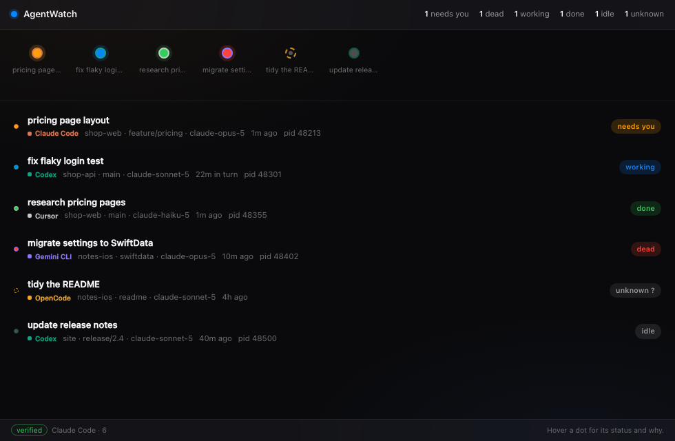

# AgentWatch

**Every coding agent, one watch.**

A native macOS status board for people who run several AI coding agents at once. It reads
the session files your agents already write — nothing to install, nothing to configure, no
account, no telemetry — and shows you who is working, who is stuck, who needs you, and who
has quietly died.



## Why

Run five agents in parallel and you stop being a developer and become a switchboard
operator. One agent sits blocked on a permission prompt in a tab you aren't looking at,
and you lose twenty minutes without knowing.

Every vendor builds a status view for *their own* agent, and will never show you the rest.
AgentWatch is the neutral one: it shows them all, because it is owned by none of them.

## What it does (today)

- One **dot per agent** on the edge of the screen — blue working, amber needs you, green done
- **`dead`** — the state other dashboards cannot produce, because they never check the process
- **`unknown`** — when it genuinely cannot tell, it says so rather than guessing
- Reads **Claude Code** transcripts; more agents are adapters, one file each

## What it does not do

- It does not run, schedule, or stop your agents.
- It does not act without you. Ever, by default.
- It does not leave your Mac.

## Status

Early. v0.1 (`M0.1`) — the board is live and truthful; the edge overlay, hooks, inbox,
theming and history are in the milestone plan.

| Milestone | State |
|---|---|
| M0.1 See — status board | 🟡 board done, edge overlay pending |
| M0.2 Answer — hooks + inbox | ⬜ |
| M0.3 Look — theming + settings | ⬜ |
| M0.4 Remember — history + weekly counts | ⬜ |
| M1.0 Everyone — all agents | ⬜ |

## Develop

```bash
npm install
npm run tauri dev          # app
cargo test --manifest-path src-tauri/Cargo.toml
cargo test --manifest-path src-tauri/Cargo.toml --test live_scan -- --ignored --nocapture
```

Requires Rust, Node 22, and the macOS Command Line Tools.

## Documentation

The `docs/` folder is the project diary: vision, scope, every decision with its reasoning,
behaviour specs, architecture, ADRs, milestones and a handoff note. Start at
[`docs/README.md`](docs/README.md). If you are an AI agent picking this up: read
[`docs/HANDOFF.md`](docs/HANDOFF.md) first.
